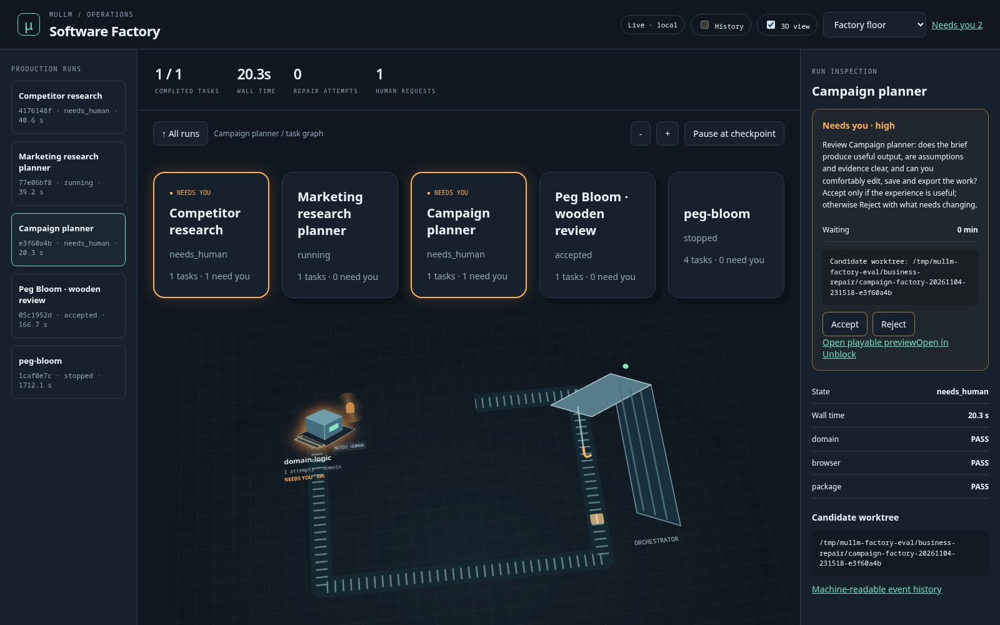
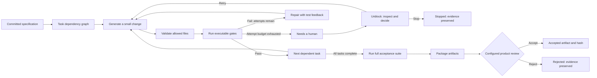
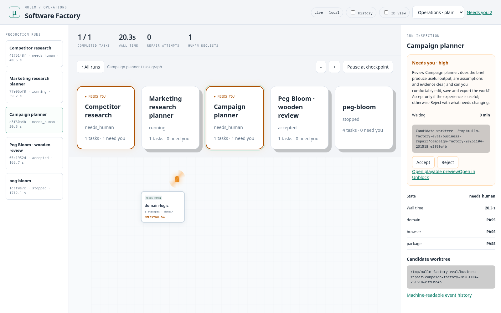
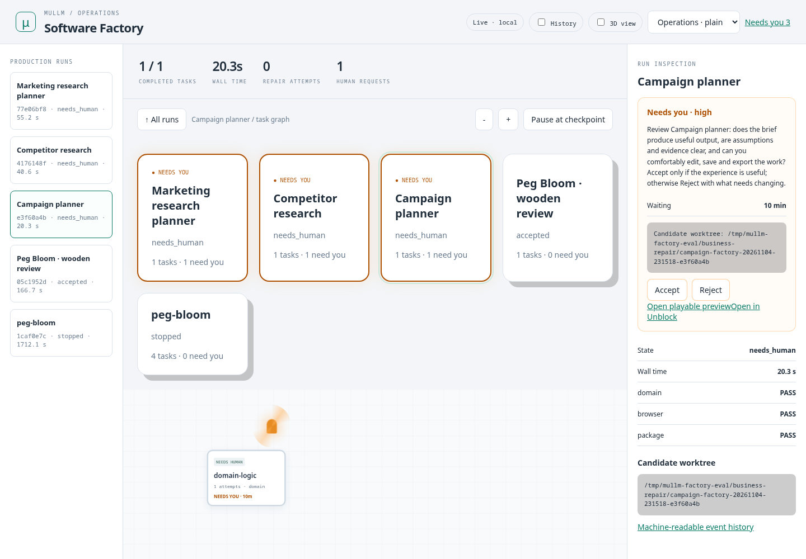
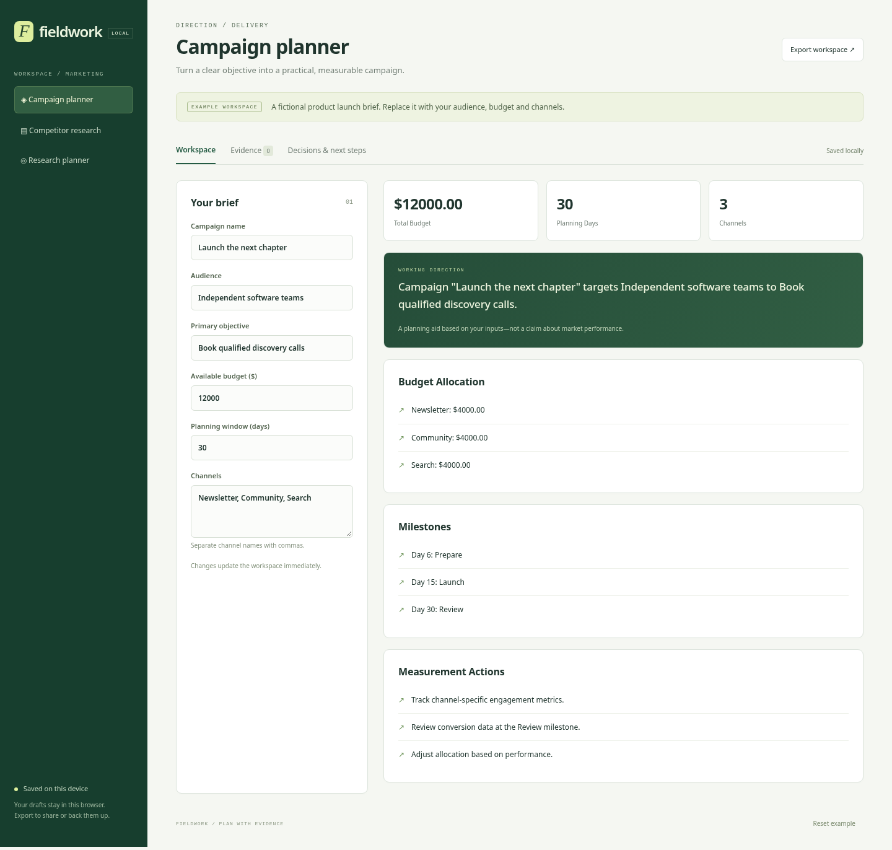

# Software Factory

**A specification goes in. A tested artifact—and the evidence behind it—comes out.**

muLLM Factory turns a committed project contract into small, dependent implementation tasks. Each task has a narrow write scope and executable checks. Failed checks feed the repair loop. When its attempt budget runs out, the worker asks for a decision through **Unblock** and waits.



[Watch the short tour](media/factory-tour.webm) · [Spec-to-game evidence](evidence/peg-bloom/README.md) · [Three marketing projects](evidence/marketing/README.md) · [Run the example](../examples/factory-peg-bloom/README.md)



## See what is happening

Open `/factory` for the live operations board. Start in flat 2D; enable **3D view** for the animated factory floor. The same runs can also be explored as an orbital network, forest, or city.

Select a run, then a task, then an attempt. The inspection panel shows its contract, model, token count, elapsed time, failed checks, decisions, and artifacts. A task with no task-level gate is an implementation step; final acceptance still runs every configured gate. Machine activity follows recorded task state. The conveyor and crane also have gentle ambient motion while idle; that motion is not a throughput measurement.



Orange beacons, forest smoke, and traffic signals identify pending human requests. Their visual size grows with waiting time, up to a limit. Clicking the affected task opens the same actionable request shown on `/unblock`. Status text and controls remain available without animation, and reduced-motion preferences are respected.



## The human handoff

A request records **what failed, which task is blocked, its severity, how long it has waited, and the available actions**. Retry grants another bounded attempt cycle; all checks still apply. Stop ends the worker and preserves its candidate and evidence. Waiting does not count as permission. A decision cannot be silently replaced by a second, conflicting answer.

**Pause at checkpoint** requests an operator decision. The worker checks before an attempt, after inference before applying files, and before final gates. An already-running inference or gate is not immediately terminated. Stopped and accepted runs remain inspectable, with terminal outcomes instead of active decision controls.

Cards and decisions persist in SQLite. The run's local JSON report and JSONL journal remain available if the dashboard disconnects. A worker process must remain alive to consume a pending decision; restarting the web server does not reconstruct a dead worker.

Declare product questions before implementation when the answer changes the work. Answers become `product_decisions` in each model prompt and remain in the report:

```toml
[[questions]]
id = "audience"
prompt = "Who will use this workspace first?"
options = ["Solo operator", "Small team"]
```

For human-facing software, add an explicit product review after the executable gates. It waits for Accept or Reject; elapsed time never accepts a candidate. The optional review link must serve the candidate worktree being evaluated.

```toml
[[gates]]
name = "product-review"
kind = "human"
prompt = "Can someone complete the main workflow comfortably, with clear feedback and recovery?"
review_url = "http://127.0.0.1:8080"
```

## Try a complete game

The [Peg Bloom example](../examples/factory-peg-bloom/README.md) supplies three independently verified peg-solitaire puzzles, public interface contracts, protected acceptance tests, and packaging instructions. Its generation manifest asks the model for the rules engine, rendering, styling, and controller. The captured wooden edition combines the locally generated engine and controller with a supplied presentation component; the evidence distinguishes those contributions.

```bash
mullm --factory factory.toml --dry-run
mullm --factory factory.toml --server-url https://127.0.0.1:6856
```

The source project must be clean and committed. Factory creates a separate Git worktree and branch. The returned report names that candidate and the evidence directory under `.git/factory/<run-id>/`. Factory does not merge or deploy the result.

For a test server on a different port, pass its URL explicitly. Local TLS certificates are trusted explicitly; verification is not disabled. Authenticated servers use `MULLM_API_KEY` or the configured muLLM key. Factory and server must have access to the appropriate local certificate configuration.

## Define the contract

The manifest declares `name`, `target`, `goals`, `business_rules`, `preferences`, `writable_files`, `context_files`, `protected_files`, `artifacts`, and `gates`. Enable `publish_events = true` for live observation and `human_intervention = true` for blocking human requests.

```toml
[[tasks]]
id = "controller"
depends_on = ["engine", "board"]
instruction = "Implement the controller using the supplied interfaces."
writable_files = ["app.mjs"]
context_files = ["contract.md", "engine.mjs", "render.mjs"]
gates = ["browser"]
max_attempts = 3
max_output_tokens = 2200

[[gates]]
name = "browser"
command = ["python3", "browser_acceptance.py"]
timeout_seconds = 60
```

Task IDs and gate names are unique. Dependency cycles and unknown dependencies are rejected. Tasks execute serially in dependency order within each project. Each task sees its current writable files plus its selected context. Give it the interface contracts it needs; removing signatures or types saves tokens at the expense of correctness. A task with `verification_only = true` runs its named gates without invoking a model; use it to verify an existing candidate or supplied component.

Gate commands are argument arrays, executed without a shell. Put acceptance suites, fixtures, and build scripts in `protected_files`; their hashes are checked during execution. Commands execute on the operator's machine with a reduced environment. A worktree isolates changes, not hostile code. Use Podman-backed commands when the project requires process or network isolation.

Match ownership to failure modes: a controller-only task cannot fix a stylesheet. Prefer small checks near each component and an integration gate spanning the product's real behavior. Failure of final acceptance leaves the run failed rather than accepting or weakening a check.

## Build multiple projects together

The [Fieldwork example](../examples/factory-business/README.md) builds a campaign planner, competitor research workspace, and research planner as independent projects. Its batch manifest lists each committed repository:

```toml
[[projects]]
root = "campaign"
spec = "factory.toml"
[[projects]]
root = "competitors"
spec = "factory.toml"
[[projects]]
root = "research"
spec = "factory.toml"
```

```bash
mullm --factory-batch workspace.toml --dry-run
mullm --factory-batch workspace.toml --server-url https://127.0.0.1:6856
```

Workers run concurrently, each in its own worktree. Published runs share a FIFO inference lease, so a project waits outside the `/query` deadline while another uses the local model. Tests and packaging can proceed independently. The lease expires if its worker disappears. This scheduler coordinates Factory workers using the same server; other inference clients do not participate in it.

The overview shows every project and its pending human requests. Each project can reach its own review gate while the others continue. The captured marketing run includes initial failures, diagnosed repairs, model responses, gate logs, and the product-review state.



## Spec-driven development and BDD

The reusable method is **specification → independent acceptance → bounded implementation → feedback → evidence**. It works with muLLM or another coding system.

BDD adds shared product language to that contract. Gherkin is one way to write it; Cucumber or another BDD runner can bind scenarios to executable steps. Factory does not require either tool: an existing BDD suite is simply another gate command.

```gherkin
Scenario: Reveal the diamond constellation
  Given the diamond board with its verified 26-jump solution
  When the player performs each legal jump
  Then exactly the finishing constellation remains
  And the move counter reads "Moves: 26 / 26"
  And the game announces "Solved"
```

This illustrative scenario maps to the real Python browser test and JavaScript rules test in the example. It is not a separate executed Gherkin suite. Maintain one executable source of truth; prose and diagrams explain it.

## Integrate other loops

The event and decision API is shared by the board and agent clients:

| Endpoint | Purpose |
|---|---|
| `POST /api/factory/runs` | Publish a versioned-by-sequence run snapshot: `run_id` and `snapshot` |
| `GET /api/factory/runs` | Discover current run snapshots |
| `GET /api/factory/runs/{id}/events?after=N` | Read append-only history after a sequence number |
| `POST /api/agents/blocked` | Register a human request with summary, context, options, severity, and optional run/task IDs |
| `GET /api/sessions/{id}` | Poll the durable decision |
| `POST /api/sessions/{id}/unblock` | Submit a decision from the operator surface |
| `POST /api/factory/runs/{id}/interrupt` | Request a pause at the worker's next checkpoint |
| `POST /api/factory/inference-lease` | Queue a published run for the shared local inference slot |
| `DELETE /api/factory/inference-lease/{id}` | Release the slot after inference |

An existing orchestrator can publish its graph and task states through this contract. Publishing a card alone does not pause a worker: the worker must wait for the decision and enforce it. The Factory worker implements that handshake. Normal API authentication applies; browser control requests are restricted to the same origin.
