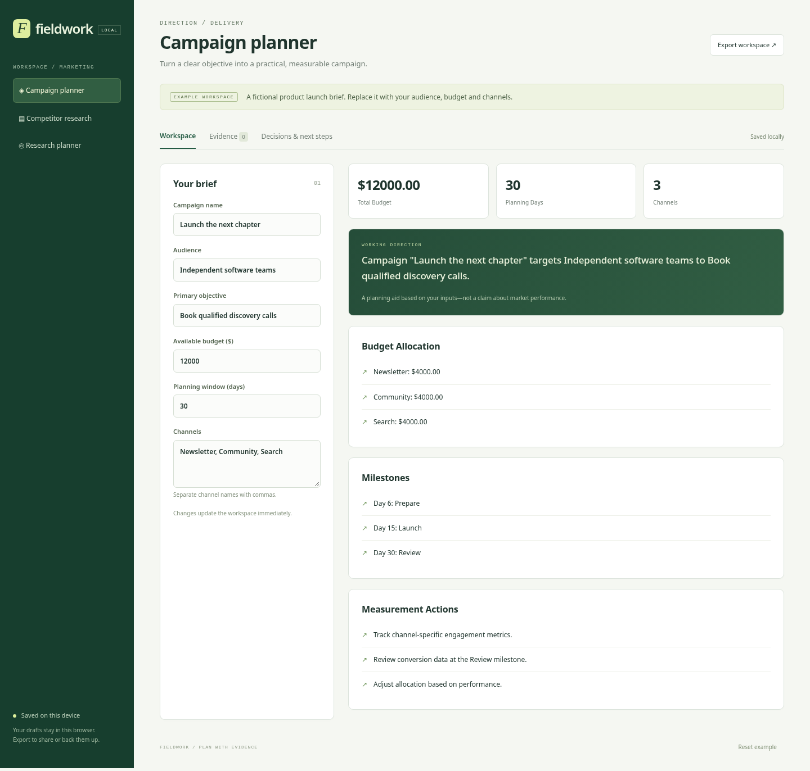

# Three marketing projects, one observable factory

The campaign planner, competitor research workspace and marketing research planner were launched as independent projects in one batch. Each used a supplied UI component kit; the local model generated `workflow.mjs`, the project's domain logic.

[Run the captured workspaces](../../../examples/factory-business/verified/) · [Contracts and instructions](../../../examples/factory-business/README.md) · [Run history](history.json)



[Competitor workspace screenshot](../../media/marketing-competitors.png) · [Research planner screenshot](../../media/marketing-research.png)

## Parallel work with one GPU

Project workers run concurrently. A shared, expiring inference lease queues model calls outside the `/query` deadline. Tests and packaging can proceed while another project generates code. The dashboard distinguishes queued work, active attempts and human requests.

The diagnosed repair batch reached product review in about **55 seconds**. The initial batch is also recorded: duplicate channel/company handling failed, and the first research draft's questions and schedule needed editorial repair. The 55-second figure excludes that earlier work and is not a complete development-time claim.

## Product behavior

| Workspace | Domain checks | Shared product checks |
|---|---|---|
| Campaign planner | Deduplicated channels, exact budget allocation, bounded milestones, invalid-input handling | Editable saved brief, evidence sources, reviewed/unreviewed labels, removal and restore, decision log, JSON export, mobile fit |
| Competitor research | Unique companies, case-insensitive evidence ownership, exact sourced claims, visible evidence gaps | Same shared checks |
| Research planner | Neutral question starters, four study phases, bounded days, evidence counts, invalid-input handling | Same shared checks |

Source links are user-supplied. A “Human-reviewed” label means the operator checked the source; the app does not independently verify it. The workspaces begin with fictional example briefs and no research findings.

Automated checks and product review are separate. The run reports record whether each review has been accepted, rejected or remains pending. A green technical gate is not presented as human acceptance.

## Evidence

Each project's `business/` directory contains its initial run; `business-repair/` contains the diagnosed repair, prompt/response records, executable gate logs and packaged workspace. Reports may include review wait time. `$EVALUATION_ROOT` replaces local machine paths.

To explore all three captured apps without inference:

```bash
cd examples/factory-business/verified
python3 -m http.server 8080 --bind 127.0.0.1
```
