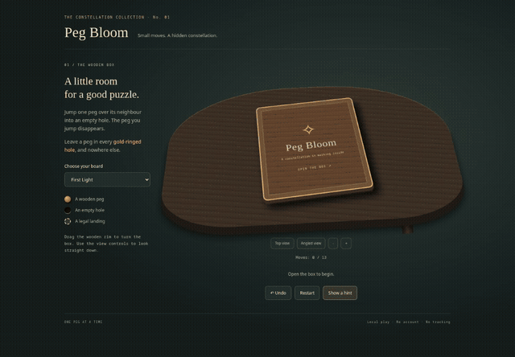
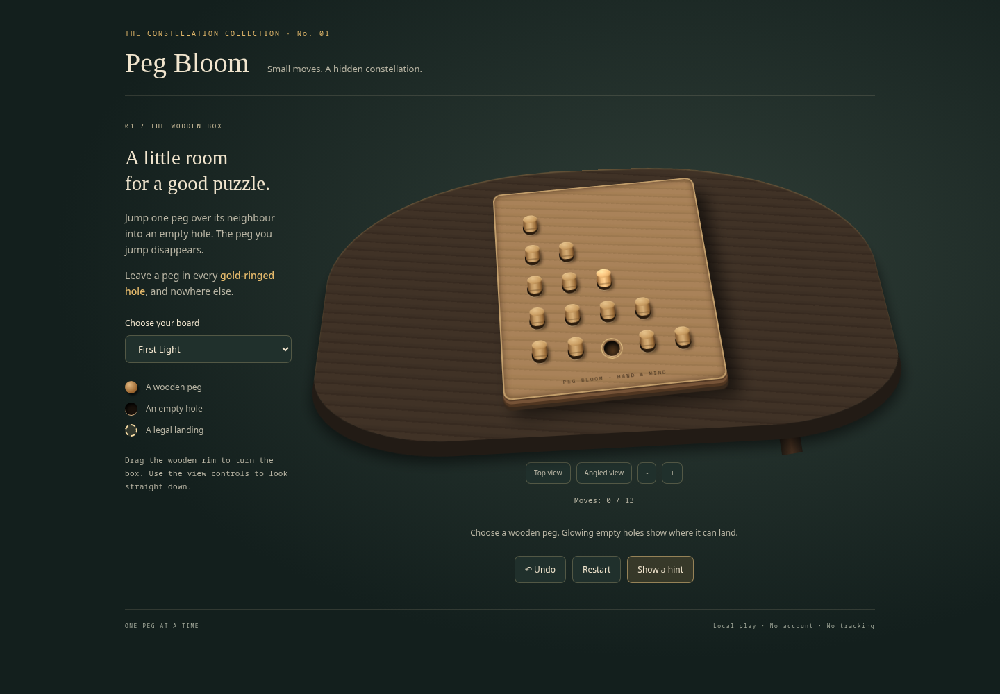
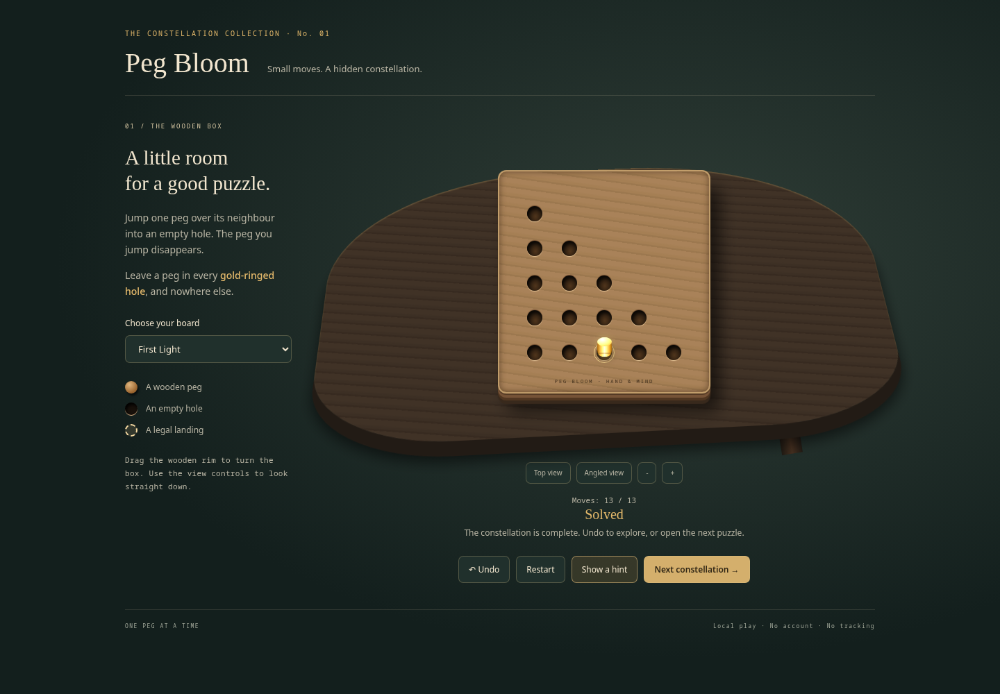

# Peg Bloom: specification → game → product review

This case study records a local-model build on an RTX 5090 using **qwen3.6-35b-a3b-chat:latest**, a Q5_K_M MoE model. It includes failures, guided repairs, and the final playability review. It is a single development experiment, not a general benchmark or an unattended-autonomy claim.

[](../../media/peg-bloom-tour.webm)

[Play the captured source locally](../../../examples/factory-peg-bloom/verified/) · [Download the accepted artifact](peg-bloom.zip) · [Machine-readable run history](history.json)

## What went in

The project supplied three puzzle fixtures, interface contracts, an HTML scaffold, independent rules and browser tests, and a ZIP build script. The puzzles contain 15, 33, and 41 cells, with recorded solutions of 13, 24, and 26 jumps. They were constructed backward from their finishing shapes and verified forward by a separate move oracle.

The model initially generated the rules engine, renderer, stylesheet and controller. Later, a reusable wooden presentation component replaced the initial rendering and styling. The accepted game's **rules and controller originated in local model runs; its wooden presentation was supplied during guided product review**. The exact source and this provenance are preserved with the artifact.

## What the process caught

| Stage | Observation | Response |
|---|---|---|
| Output contract | The model copied a placeholder filename | Enforce a JSON schema containing the actual allowed filenames |
| Rules | Coordinate strings were mistaken for arrays | Supply short, explicit interface examples and compare against an independent oracle |
| Context and deadlines | Large generation requests timed out at 29 seconds | Keep small tasks, scoped context and the model's tuned 16K context on the evaluation server |
| Interaction | Empty landing clicks and solution-prefix hints were wrong | Diagnose the defects, then request a bounded local-model repair |
| Responsive layout | Gameplay passed but mobile overflow remained | Route the failure to a task allowed to edit CSS |
| Visual review | A technically passing game had oversized, indistinct pegs | Reject functional checks as a complete product-quality bar; add visible-state checks and a tactile presentation component |
| Product review | The revised wooden game was reviewed for playability | Record explicit acceptance separately from automated checks |

The first complete gameplay repair still needed a layout repair. The layout-only run took **32.4 seconds**, including full verification. That number is **not** the total time to develop the game. Full wall times and task-attempt times are retained in [history.json](history.json); wall time may include waiting for a human.

A fresh build from the clarified specification also failed its browser gate. That negative result is retained. The current local model did not reliably complete this product from scratch without guidance.

## What was checked

- All **63 jumps** against an independent legal-move implementation.
- Exact goal equality, illegal-move rejection and immutable state transitions.
- Real browser clicks, board switching, hints, undo and restart.
- Mobile fit, visible peg/empty-hole distinction and a first move selected through visible landing affordances rather than the recorded solution.
- The wooden presentation's completion camera and undo transition.
- No browser exceptions or external network requests during the acceptance run.
- A separate human playability decision before final acceptance.





## Inspect or reproduce

Each `runs/<id>/` directory contains the contract used for that run, its report, available prompt/response records and gate logs. Local evaluation paths are replaced by `$EVALUATION_ROOT`; artifact hashes retain their original values. No provider credentials are included.

Use the [example instructions](../../../examples/factory-peg-bloom/README.md) to generate a new candidate. To inspect the captured accepted game without inference:

```bash
cd examples/factory-peg-bloom/verified
python3 -m http.server 8080 --bind 127.0.0.1
```

The final ZIP SHA-256 is **`dc8519d616c237699593d7ee5cb189b420c74d74bb4151aa60c2aeb15272b0e7`**. The runnable source snapshot includes `provenance.json` so a screenshot cannot be mistaken for proof of fully autonomous generation.
